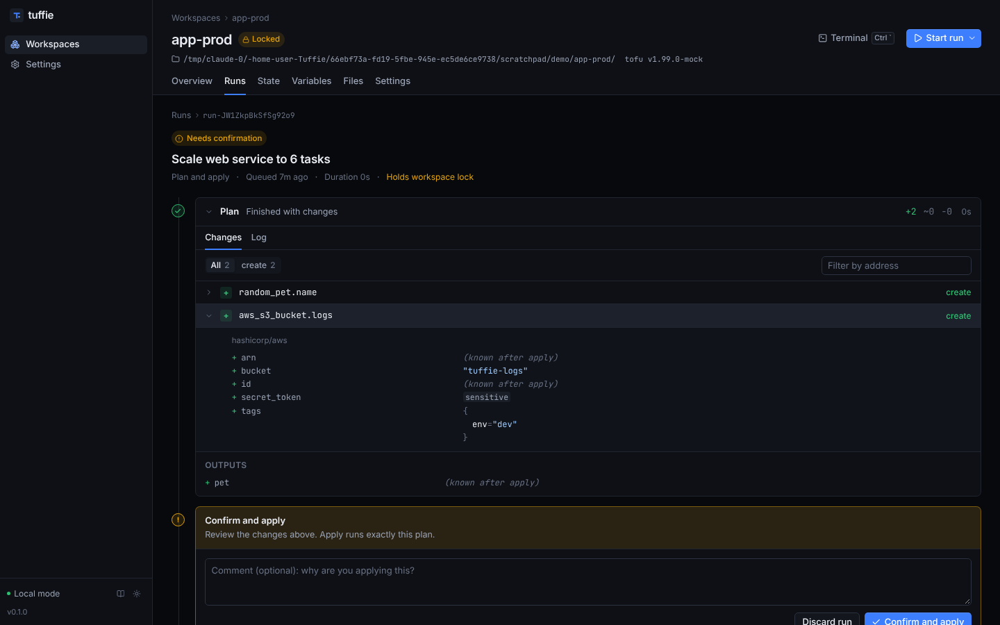
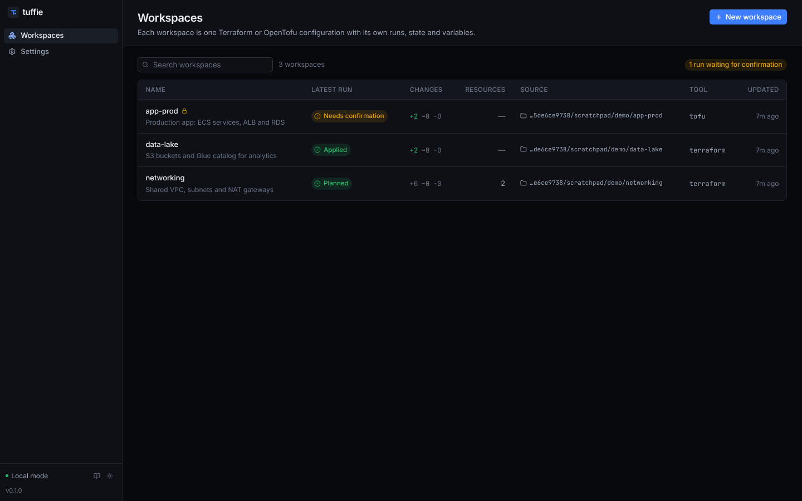
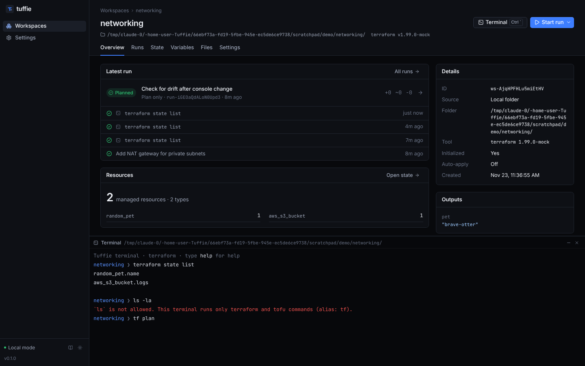
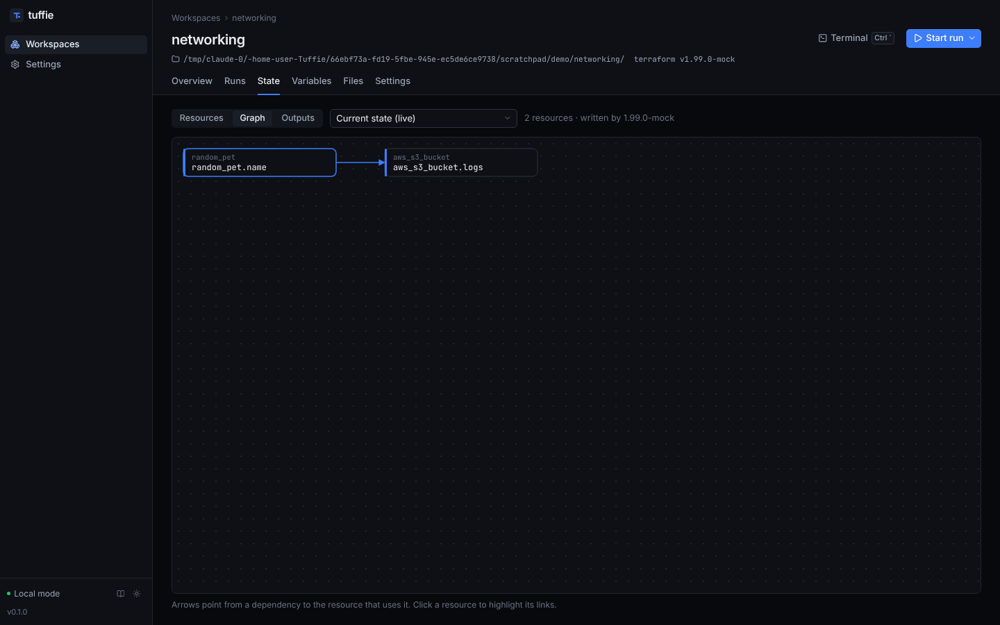
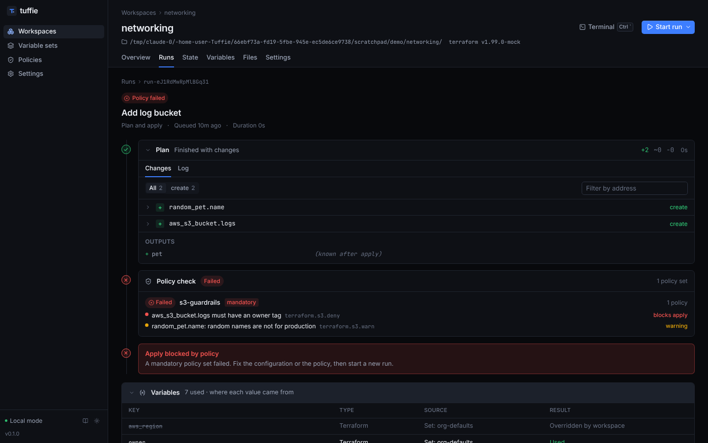
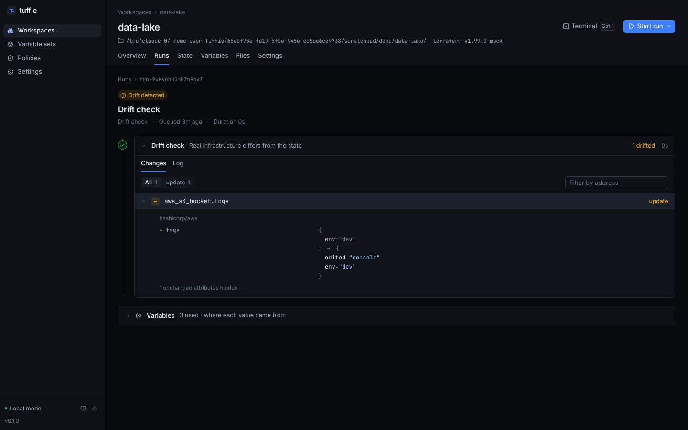

# Tuffie

**A fast, local-first UI for Terraform and OpenTofu.** One small Rust binary. Run it on your laptop, or self-host it for your team.

Tuffie is a companion to the CLI, not a replacement for it. It gives you the things the CLI does badly: a readable plan diff, a state browser, run history, safe approvals and a dependency graph. It also has an integrated terminal, so you never have to leave the UI to run a command.

> Status: early development (v0.1). The local mode works end to end. The team (server) mode is on the roadmap.



| Workspaces | Terminal | Dependency graph |
|---|---|---|
|  |  |  |
| **Policy check** | **Drift detection** | |
|  |  | |

## Features

- **Workspaces** — one per configuration. The source is a local folder or a Git repository.
- **Runs, like HCP Terraform** — *Plan and apply*, *Plan only*, *Refresh state* (drift) and *Destroy*. A plan waits for your confirmation before apply. Auto-apply is a setting for each workspace.
- **Plan review** — every resource change as a readable attribute diff (create, update, replace, destroy), with filters.
- **Queue and lock** — one run at a time for each workspace. A plan that waits for approval keeps the lock, so the apply matches what you reviewed.
- **Live logs** — streamed over WebSocket while the run is active.
- **State browser** — resources grouped by module, attribute values, outputs and a dependency graph. Tuffie saves a state snapshot after every apply, so you get state history with any backend.
- **Variables** — Terraform and environment variables, HCL values, and sensitive (write-only) values.
- **Variable sets** — share variables (credentials, tags, regions) with all workspaces or with the workspaces you choose. Each run shows where every variable came from.
- **Policy checks** — Rego (Open Policy Agent) policies run on every plan, inside Tuffie, with no `opa` binary to install. *Mandatory* sets block the apply; *advisory* sets warn. Conftest-style `deny`, `violation` and `warn` rules work as they are.
- **Drift detection** — a schedule for each workspace (hourly to weekly) or a *Check now* button. Drifted workspaces are flagged on the list, with an attribute diff of what changed outside Terraform.
- **File editor** — edit `.tf` files with HCL syntax highlighting. Press `Ctrl+S` to save.
- **Integrated terminal** — runs `terraform`, `tofu` and `tf` (an alias) in the workspace folder, with your variables set. Every command shows up in the run history.
- **Terraform and OpenTofu** — choose the tool for each workspace.
- **Guided tours** — a welcome tour on first start, then short tours for a workspace and for run review. Replay them from **Help** (press `?`).
- **Built-in documentation** — the full [user guide](docs/guide/README.md), searchable inside the app at `/docs`.
- **Dark and light themes.**

## Quick start

Requirements: Linux or macOS, and `terraform` or `tofu` on your `PATH`.

1. Build Tuffie (Rust 1.80+ and Node 22+ are required):

   ```sh
   make build
   ```

2. Start it:

   ```sh
   ./target/release/tuffie
   ```

   Tuffie opens `http://127.0.0.1:7777` in your browser.

3. Click **New workspace**. Select **Local folder** and enter the path to a folder with `.tf` files. You can use `examples/basic`: it needs no cloud account.

4. Click **Start run → Plan and apply**. Review the plan, then click **Confirm and apply**.

5. Press `` Ctrl+` `` to open the terminal. Type `tf state list`.

New to Tuffie? The guided tour starts on first launch. Read the [user guide](docs/guide/README.md) for every feature.

### Options

| Flag | Environment variable | Default | What it does |
|---|---|---|---|
| `--listen` | `TUFFIE_LISTEN` | `127.0.0.1:7777` | Address to listen on. Local mode accepts only loopback addresses. |
| `--data-dir` | `TUFFIE_DATA_DIR` | `~/.local/share/tuffie` (Linux), `~/Library/Application Support/tuffie` (macOS) | Database, run logs and the master key. |
| `--mode` | `TUFFIE_MODE` | `local` | `local` (one user, no login) or `server` (team; needs SSO, see the roadmap). |
| `--allowed-host` | `TUFFIE_ALLOWED_HOSTS` | — | Extra host names to accept, for example behind a reverse proxy. |
| `--inherit-env` | `TUFFIE_INHERIT_ENV` | `true` in local mode | Runs see your shell environment (`AWS_PROFILE`, `~/.aws`, …). |
| `--no-open` | `TUFFIE_NO_OPEN` | — | Do not open the browser. |
| — | `TUFFIE_MASTER_KEY` | — | Base64 32-byte key. Use it instead of the key file. |
| — | `TUFFIE_LOG` | `info` | Log filter, for example `debug`. |

## Security

Security is a design goal, not an add-on.

- **Secrets are encrypted at rest.** Variable values, saved plans and state snapshots use XChaCha20-Poly1305. The master key is in `<data-dir>/master.key` (mode `0600`) or in `TUFFIE_MASTER_KEY`. **Back up the key.** Without it, Tuffie cannot read your variables.
- **Sensitive values are write-only.** The API never returns them. Tuffie replaces them with `***` in run logs and terminal output, and masks values that Terraform marks as sensitive in plans and state.
- **Binary plan files are deleted** after apply or discard.
- **Local mode is loopback only.** Tuffie checks the `Host` and `Origin` headers on every request. This stops other web sites and DNS-rebinding attacks from calling your local Tuffie.
- **The terminal is not a shell.** It runs only `terraform`/`tofu`, without a shell, in the workspace folder. Pipes, redirects, `-chdir` and other programs are refused.
- **The file editor cannot leave the workspace folder** (it checks `..` and symlinks) and does not open `.tfstate` files.
- **Git:** the `ext::` transport and repository hooks are disabled.

See the [security guide](docs/guide/security.md) and [docs/ARCHITECTURE.md](docs/ARCHITECTURE.md) for the full security model.

## Development

```sh
make dev     # backend on :7777, Vite dev server with hot reload on :5173
make test    # Rust unit tests + Svelte type check
make smoke   # end-to-end test with a mock terraform binary
```

Stack: Rust (axum, tokio, SQLite via sqlx, portable-pty) and SvelteKit 3 with Svelte 5, Tailwind CSS 4, Bits UI, xterm.js and CodeMirror 6. The UI is built to static files and embedded in the binary.

## Roadmap

Ticked items are done. The order inside a phase is not fixed.

### Phase 1 — Local MVP (v0.1)

- [x] Single binary with an embedded web UI
- [x] Workspaces from a local folder
- [x] Workspaces from a Git repository (clone, sync, branch/tag/commit)
- [x] Terraform and OpenTofu, chosen per workspace, with an optional binary path
- [x] Runs: plan and apply, plan only, refresh state, destroy
- [x] Approval before apply, with a comment
- [x] Auto-apply setting
- [x] Run queue and workspace lock
- [x] Cancel a run (graceful interrupt)
- [x] Live run logs over WebSocket
- [x] Plan review with an attribute-level diff
- [x] State browser: resources, attributes, outputs
- [x] State history (snapshot after every apply)
- [x] Resource dependency graph
- [x] Terraform and environment variables, HCL values
- [x] Sensitive variables: encrypted, write-only, redacted in output
- [x] File editor with HCL highlighting
- [x] Integrated terminal limited to terraform/tofu commands
- [x] Terminal commands recorded in run history and protected by the workspace lock
- [x] Local backend
- [x] Dark and light themes
- [x] Local-mode protection (loopback only, Host and Origin checks)
- [ ] Test the S3 backend end to end (it works through your own `backend "s3"` block, but it is not tested yet)
- [x] Scheduled drift detection, and a *Check now* button
- [x] Policy checks with Rego (OPA) before apply: advisory and mandatory sets, inline or from a folder
- [x] Test a policy set against the saved plan of an earlier run
- [x] Variable sets shared by many workspaces (global or assigned)
- [x] Variable origin tracing for each run
- [ ] Soft-mandatory policies that an admin can override
- [ ] Notify when drift is found (see Phase 2 notifications)
- [ ] Install and switch Terraform / OpenTofu versions from the UI
- [x] Guided tours (welcome, workspace, run review) and a sample project
- [x] User guide, also built into the app with search
- [ ] Command palette (`Ctrl+K`) and global search
- [ ] Download plan JSON and run logs
- [ ] Release binaries for Linux and macOS (x86_64 and arm64)

### Phase 2 — Self-hosted for teams

- [ ] Server mode with SSO login (OIDC: Keycloak, Google, GitHub, Okta …)
- [ ] Simple RBAC per workspace: admin, writer, reader
- [ ] Audit log
- [ ] PostgreSQL as an option
- [ ] Docker image and Helm chart
- [ ] Run each run in an isolated container
- [ ] Remote agents (run in another network)
- [ ] Notifications: Slack, email, webhooks
- [ ] HashiCorp Vault and SOPS for secrets

### Phase 3 — VCS workflows

- [ ] Webhooks from GitHub and GitLab: plan on pull request
- [ ] Plan summary as a pull-request comment
- [ ] Apply on merge
- [ ] Run triggers between workspaces

### Later

- [ ] Tuffie as a state backend (HTTP backend with locking)
- [ ] Private module and provider registry
- [ ] Cost estimation
- [ ] Desktop app (Tauri)
- [ ] Windows support

## License

[MIT](LICENSE)
