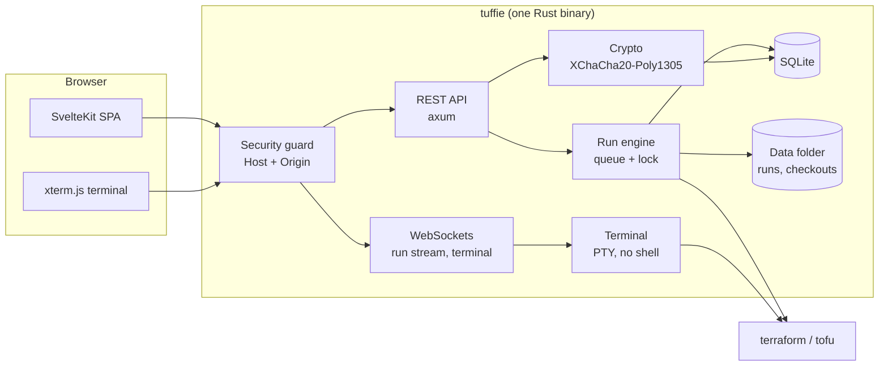
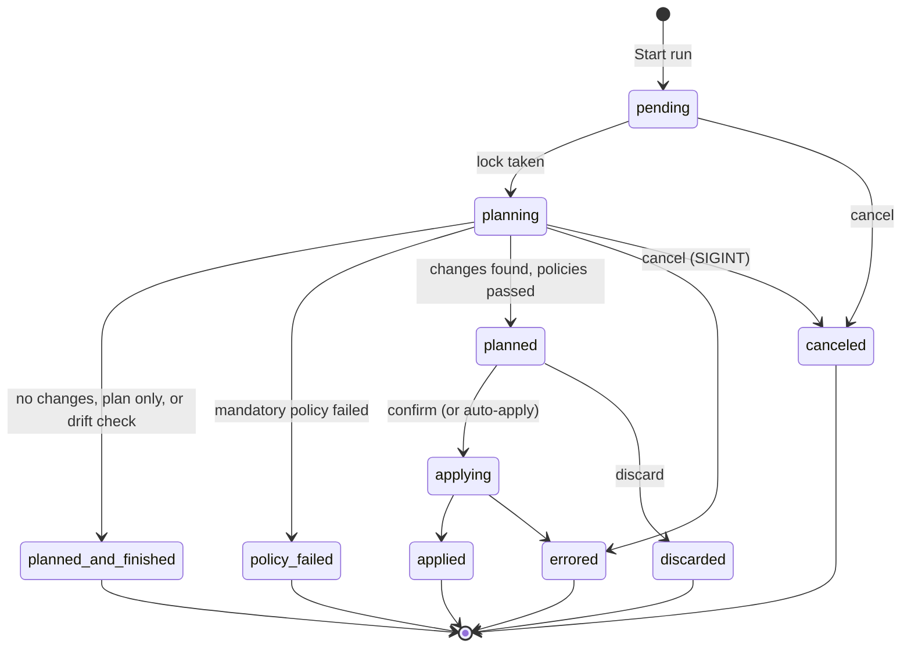

# Tuffie architecture

This document explains how Tuffie works inside. Read it before you change the run engine, the terminal or the security checks.

## Overview

Tuffie is one process. It serves a REST + WebSocket API and the web UI. It does not reimplement Terraform: it runs the real `terraform` or `tofu` binary and reads its machine-readable output.



## Source layout

| Path | What it holds |
|---|---|
| `src/main.rs` | Start-up: config, database, master key, recovery, HTTP server. |
| `src/config.rs` | Command-line flags and `TUFFIE_*` environment variables. |
| `src/api/` | REST handlers: workspaces, runs, variables, files, state. |
| `src/runner.rs` | Run engine: queue, lock, plan → confirm → apply, event log. |
| `src/terminal.rs` | Terminal WebSocket: command parsing, PTY, run recording. |
| `src/exec.rs` | Tool lookup, working folder, environment, secret redaction. |
| `src/crypto.rs` | Encryption at rest. |
| `src/policy.rs` | Rego policy evaluation (regorus, in-process). |
| `src/api/assign.rs` | Global / per-workspace assignment for variable and policy sets. |
| `src/security.rs` | Host and Origin checks, security headers. |
| `src/git.rs` | Clone and sync Git sources with the system `git`. |
| `src/assets.rs` | Serves the embedded UI (`web/build`). |
| `migrations/` | SQLite schema. |
| `web/` | SvelteKit 3 single-page app. |
| `tests/fixtures/mock-terraform` | Fake `terraform` used by tests. |

## Run lifecycle



Steps of one run:

1. The API inserts a `pending` run and calls `kick()` for the workspace.
2. `kick()` takes the oldest pending run. It takes the workspace lock with one atomic `UPDATE … WHERE lock_run_id IS NULL`. If another run holds the lock, the run waits.
3. `init -input=false` runs every time. A shared plugin cache (`TF_PLUGIN_CACHE_DIR`) keeps it fast.
4. `plan -json -detailed-exitcode -out=plan.tfplan` runs. Exit code `2` means changes. Tuffie reads each JSON line and writes it as a run event. `change_summary` sets the add/change/destroy counts.
5. `show -json plan.tfplan` exports the structured plan. Tuffie encrypts it to `plan.json.enc`.
6. Policy check: every policy set that applies to the workspace is evaluated against the plan JSON. If a *mandatory* set fails, the run ends as `policy_failed`, the binary plan is deleted and the lock is released. Drift checks skip this step.
7. With changes, the run becomes `planned` and **keeps the lock**. Nothing else can change the state before the apply.
8. On confirm, `apply -json plan.tfplan` runs the exact plan that was reviewed.
9. After apply, `state pull` saves an encrypted state snapshot. This gives state history with any backend.
10. The lock is released and `kick()` starts the next pending run.

On start, runs that were active when Tuffie stopped are marked `errored`, and their locks are released.

### Run events

Each run has `runs/<id>/events.jsonl`. A line is:

```json
{"seq": 12, "ts": "…", "stage": "plan", "level": "info", "message": "Plan: 2 to add…", "type": "change_summary", "data": {…}}
```

The `/api/runs/{id}/stream` WebSocket subscribes to the live channel first, then sends the file, then the live events. It drops duplicates by `seq`, so no event is lost or repeated.

## Variables and variable sets

Precedence, lowest first (the last one wins):

1. The Tuffie process environment (all of it in local mode, an allow-list in server mode).
2. Global variable sets, sorted by name.
3. Variable sets assigned to the workspace, sorted by name.
4. The workspace's own variables.

Each run writes `variables.json`: every key, its source, and whether a later source overrode it. It never holds values. The run page shows it as a table.

## Policy checks

Tuffie evaluates Rego with [regorus](https://github.com/microsoft/regorus), a Rust implementation of the OPA language. There is no `opa` binary and no network access from policies (the `http` builtins are not compiled in). Each evaluation has a 10-second limit.

- Input: the plan JSON from `terraform show -json` (`input.resource_changes`, `input.resource_drift`, `input.configuration`, …).
- Rules named `deny` or `violation` are failures. Rules named `warn` are warnings. Any package can define them.
- A rule value is a set of strings, or of objects with a `msg` field. Other fields show as details.
- Rego v1 syntax is preferred. Rego v0 syntax (`deny[msg] { … }`) is accepted as a fallback, so most Conftest policies work unchanged.
- Policies are compiled when you save them, so a syntax error is shown at once.

| Enforcement | A failing `deny` … |
|---|---|
| advisory | shows as a warning. Apply is allowed. |
| mandatory | blocks the apply. The run ends as `policy_failed`. |

A policy set either stores policies in Tuffie (with a Rego editor), or reads `*.rego` files from a folder (for example a Git checkout). Files that end in `_test.rego` are skipped.

## Drift detection

A drift check is a run of kind `drift`: `plan -refresh-only`, never applied, no policy check. Exit code 2 means the real infrastructure differs from the state. The workspace stores the result (`drift_status`, `drift_count`, `drift_checked_at`, `drift_run_id`).

A scheduler task wakes every 30 seconds. It starts a check for each workspace whose interval has passed, but only when the workspace has no queued, active or unconfirmed run. A successful apply marks a drifted workspace as `ok`, because the apply refreshed the state.

## Terminal

The terminal is the most sensitive feature, because it runs programs.

- The browser runs the line editor (history, Tab completion, cursor keys). The server receives **one complete command line**.
- The server splits the line like a shell (`shell-words`), but **there is no shell**. The first word must be `terraform`, `tofu` or `tf`. The server runs the workspace's binary directly in a PTY.
- Pipe and redirect tokens (`|`, `;`, `&&`, `>`) and `-chdir` are refused.
- The working folder is always the workspace folder.
- Workspace variables are set. `TF_INPUT` is not set, so interactive prompts (for example "Enter a value: yes") work.
- Every command is saved as a run with `kind = cli` and `source = terminal`. The raw output (with colors) is saved to `runs/<id>/output.log`, with secrets redacted.
- Commands that can change state or files take the workspace lock. Read-only commands (`state list`, `show`, `output`, `validate`, `fmt -check`, …) do not.

Protocol: see the comment at the top of `src/terminal.rs`.

## Security model

### Threats and defences

| Threat | Defence |
|---|---|
| Another web site calls the local API (CSRF) | `Origin` must match `Host` for writes and WebSocket upgrades. |
| DNS rebinding to `127.0.0.1` | `Host` must be a loopback name or an `--allowed-host`. |
| Local mode exposed on the network | Local mode refuses non-loopback `--listen` addresses. |
| Secrets read from the database or disk | XChaCha20-Poly1305 for variables, plan JSON and state snapshots. The record or run id is the associated data, so a copied ciphertext does not decrypt in another place. |
| Secrets shown in the UI | Sensitive variables are write-only. Values that Terraform marks as sensitive are masked in plan and state views. |
| Secrets in logs | Sensitive variable values are replaced with `***` in run events and terminal output. |
| Leftover plan files | `plan.tfplan` is deleted after apply, discard, or a plan with no changes. |
| Path traversal in the file editor | Relative paths only, no `..`, canonical path must stay inside the source root (stops symlink escapes). `.terraform`, `.git` and `.tfstate` files are blocked. |
| Command injection from the terminal | No shell. Allow-list for the program name. `-chdir` refused. |
| Malicious Git URL | Only `https://`, `ssh://`, `git@`, `file://`. `protocol.ext.allow=never`, hooks disabled, no prompts. |
| Server mode without login | Refused unless `--unsafe-no-auth` is given (for testing behind your own auth proxy). |

### Known limits (v0.1)

- In local mode, runs see your shell environment (`--inherit-env`). This is on purpose: Tuffie must work like your terminal. In server mode it is off.
- A Terraform configuration can run any code (providers, `local-exec`, `external` data sources). Tuffie cannot make untrusted configurations safe. Phase 2 adds container isolation for each run.
- Redaction replaces exact values only. A secret that Terraform changes (for example base64) is not redacted. Values that Terraform marks as sensitive are still masked in plans and state.
- The terminal limits commands, but `terraform console` can still read files through `file()`. Every configuration can do this too.

## Data folder

```
<data-dir>/            mode 0700
  tuffie.db            SQLite (WAL)
  master.key           base64 key, mode 0600 (not used when TUFFIE_MASTER_KEY is set)
  plugin-cache/        shared provider cache
  checkouts/<ws-id>/   Git sources
  cache/<ws-id>.count  resource count for the workspace list
  runs/<run-id>/
    events.jsonl       run events
    plan.tfplan        binary plan, only while it can be applied
    plan.json.enc      encrypted structured plan
    state.json.enc     encrypted state snapshot after apply
    output.log         terminal output (CLI runs)
    policy.json        policy check results (messages only, redacted)
    variables.json     variable origins (keys and sources, no values)
```

## API

All paths start with `/api`.

| Method | Path | Purpose |
|---|---|---|
| GET | `/system/info` | Version, mode, detected tools. |
| GET, POST | `/workspaces` | List, create. |
| GET, PATCH, DELETE | `/workspaces/{id}` | Read, update, delete. |
| POST | `/workspaces/{id}/sync` | Fetch and check out the Git ref. |
| GET, POST | `/workspaces/{id}/runs` | List, start (`kind`: `plan_only`, `plan_and_apply`, `destroy`, `refresh`). |
| GET | `/runs/{id}` | Run details. |
| GET | `/runs/{id}/events` | All events. |
| WS | `/runs/{id}/stream` | Live events. |
| GET | `/runs/{id}/plan` | Structured plan, sensitive values masked. |
| GET | `/runs/{id}/output` | Terminal output of a CLI run. |
| GET | `/runs/{id}/state` | State snapshot saved after this run. |
| POST | `/runs/{id}/apply` | Confirm. Body: `{"comment": "…"}`. |
| POST | `/runs/{id}/discard` | Discard a planned run. |
| POST | `/runs/{id}/cancel` | Cancel a pending or active run. |
| GET, POST | `/workspaces/{id}/variables` | List, create. |
| PATCH, DELETE | `/variables/{id}` | Update, delete. |
| GET | `/workspaces/{id}/files` | File tree. |
| GET, PUT | `/workspaces/{id}/files/content?path=` | Read, write one file. |
| GET | `/workspaces/{id}/state` | Current state (`show -json`), masked. |
| GET | `/workspaces/{id}/state-versions` | Saved snapshots. |
| WS | `/workspaces/{id}/terminal` | Terminal. |
| POST | `/workspaces/sample` | Create the sample project (used by the guided tour). |
| POST | `/workspaces/{id}/drift` | Start a drift check now. |
| GET | `/workspaces/{id}/variable-sets` | Sets that apply, in precedence order. |
| GET, POST | `/variable-sets` | List, create (`global`, `workspace_ids`). |
| GET, PATCH, DELETE | `/variable-sets/{id}` | Read, update, delete. |
| POST | `/variable-sets/{id}/variables` | Add a variable to a set. |
| GET, POST | `/policy-sets` | List, create. |
| GET, PATCH, DELETE | `/policy-sets/{id}` | Read, update, delete. |
| POST | `/policy-sets/{id}/policies` | Add a policy (compiled first). |
| PATCH, DELETE | `/policies/{id}` | Update, delete a policy. |
| POST | `/policy-sets/{id}/test` | Evaluate against a run's saved plan. Body: `{"run_id": "…"}`. |
| GET | `/runs/{id}/policy` | Policy results of a run. |
| GET | `/runs/{id}/variables` | Variable origins of a run. |

## Documentation and tours

- The user guide is Markdown in `docs/guide/`. The web build bundles it (`import.meta.glob`), and `/docs` renders it with `marked` and `DOMPurify`. Links between guide pages become app routes; other links go to GitHub. So GitHub and the app always show the same text.
- A Rust test compiles every Rego example in `docs/guide/policies.md`, so the examples cannot go stale.
- Guided tours use `driver.js` (`web/src/lib/tour.ts`). A step points at an element with a `data-tour="…"` attribute. Steps whose element is missing are skipped. A finished or closed tour is stored in `localStorage` (`tuffie-tour:<name>`), so it starts only once.

## Design system

The UI uses one accent colour (signal blue) on graphite surfaces. The tokens are in `web/src/app.css`.

| Token | Dark | Light | Use |
|---|---|---|---|
| `--bg` | `#08090c` | `#f6f7f9` | Page background |
| `--surface` | `#0e1015` | `#ffffff` | Cards, panels |
| `--border` | `#20252f` | `#e1e5ec` | Dividers |
| `--fg` | `#e8ebf1` | `#0d1117` | Main text |
| `--primary` | `#3d7eff` | `#1f5fff` | Actions, focus, selection only |
| `--success` | `#2fbf71` | `#138a4b` | Create, applied |
| `--warning` | `#e5a50a` | `#a76f00` | Update, needs confirmation |
| `--danger` | `#f0524f` | `#d22d2a` | Destroy, errors |
| `--violet` | `#a585ff` | `#6d48e0` | Replace, data sources |

### Type scale

One scale for the whole UI (`--text-*` in `app.css`, used as `text-xs`, `text-base` …). Do not use arbitrary sizes.

| Token | Size | Use |
|---|---|---|
| `2xs` | 11 px | Uppercase labels, badges, key caps |
| `xs` | 12 px | Meta text, hints, timestamps |
| `sm` | 12.5 px | Table cells, secondary text |
| `base` | 13 px | Body text and controls |
| `md` | 14 px | Emphasized body, resource titles |
| `lg` | 15 px | Dialog and card titles |
| `xl` | 17 px | Run titles |
| `2xl` | 20 px | Page titles |
| `3xl` | 28 px | Large numbers |

### Sizes and radii

| Element | Size | Radius |
|---|---|---|
| Button `sm` / `md` / `lg` | 28 / 32 / 36 px high | 6 px |
| Icon button `icon-sm` / `icon` | 28 / 32 px square | 6 px |
| Input, select | 32 px high | 6 px |
| Card, table, panel | — | 8 px |
| Dialog, popover | — | 12 px / 8 px |
| Status pill | 22 px high | full |
| Tag badge | 20 px high | 4 px |

Use `lg` buttons only for the main call to action on an empty page.

### Motion

Tuffie uses "productive" motion (after [IBM Carbon](https://carbondesignsystem.com/elements/motion/overview/)): fast and quiet, so it helps people follow a change and never makes them wait.

| Token | Value | Use |
|---|---|---|
| `--dur-press` | 90 ms | Button press scale |
| `--dur-fast` | 140 ms | Hover, color, focus ring |
| `--dur-base` | 200 ms | Menus, tab and nav indicators, small reveals |
| `--dur-slow` | 260 ms | Dialogs, drawers, collapsible panels |
| `--dur-page` | 280 ms | Page changes |
| `--ease-enter` | `cubic-bezier(0.16, 1, 0.3, 1)` | Things that arrive: decelerate into place |
| `--ease-exit` | `cubic-bezier(0.4, 0, 1, 1)` | Things that leave: accelerate away, 30% faster |
| `--ease-move` | `cubic-bezier(0.2, 0, 0, 1)` | Things that change size or position |

Patterns:

| Pattern | How | Where |
|---|---|---|
| State change | Global `transition` on interactive elements (color, background, border, shadow, opacity) | Every button, link, input, row |
| Press | `pressable`: scale 0.97 | Buttons, nav items |
| Dialog | `motion-overlay` + `motion-dialog`: fade, rise 6 px, scale 0.98 | `ui/Dialog.svelte` |
| Menu | `motion-menu`: fade and scale from the trigger | `ui/Menu.svelte` |
| Sliding indicator | `use:indicator` + `<span data-indicator>` | Sidebar, workspace tabs, segmented controls, docs nav |
| Expand / collapse | `in:reveal out:conceal` (height + opacity) | Plan rows, run panels, file tree, scope picker |
| List changes | `animate:flip in:rise out:vanish` | Runs, workspaces, variables, plan changes |
| Loading | Skeletons with the final layout, then `motion-rise` | Every page |
| Page change | View Transitions API: main area fades and rises; workspace header and terminal stay still | `routes/+layout.svelte` |
| Drawer | Height transition with fixed-height content | Terminal |
| Theme switch | One cross-fade of the page | `app.svelte.ts` |

Rules:

- Animate only `opacity` and `transform` (and height for reveals). Never animate layout on hover.
- No layout shift on load: a placeholder must have the same size as the content that replaces it. Check with the browser's Cumulative Layout Shift score.
- A button keeps its width while it shows a spinner.
- With `prefers-reduced-motion`, durations drop to near zero, nothing slides or scales, and page transitions are off.
- Motion never carries meaning alone. Every state also has a color, an icon or a label.

Rules:

- Do not use pure black. Near-black with a cool tint reduces eye strain in long sessions.
- Show depth with surface tone steps, not with shadows or gradients.
- Use blue only where the user can act. Status colours follow Terraform's plan symbols (`+ ~ − ±`).
- Inter for UI text, JetBrains Mono for code, addresses and IDs. Ligatures are off in code.
